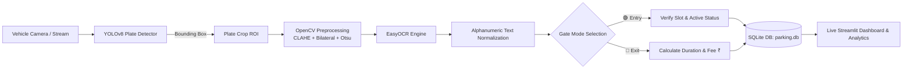

<div align="center">

# 🚗 Smart Parking Entry & Exit Logger

### *Next-Gen Automatic Number Plate Recognition (ANPR / ALPR) Parking Management & Dynamic Billing System*

[](https://www.python.org/)
[](https://github.com/ultralytics/ultralytics)
[](https://github.com/JaidedAI/EasyOCR)
[](https://streamlit.io/)
[](https://www.sqlite.org/)
[](https://opencv.org/)
[](LICENSE)

[**Explore Documentation**](PROJECT_REPORT.md) • [**Quickstart**](#-quickstart-guide) • [**System Architecture**](#-system-architecture) • [**Model Studio**](#-model-training--fine-tuning) • [**Contributing**](CONTRIBUTING.md)

</div>

---

## 🌟 Overview

The **Smart Parking Entry & Exit Logger** is an intelligent, automated parking management and revenue logging system powered by **YOLOv8**, **OpenCV**, **EasyOCR**, and **Streamlit**. It solves real-world parking congestion, manual ticketing errors, and revenue leakage through automated number plate detection, multi-stage image preprocessing, discrete half-hour tariff calculation, and real-time lot capacity monitoring.

Designed for commercial parking garages, shopping malls, smart city infrastructure, and gated facilities.

---

## 🚀 Key Features

- **🎯 Dual-Model YOLOv8 Detection**:
  - `license_plate_detector.pt`: Ultra-fast YOLOv8 nano model optimized for real-time edge processing (6.2 MB).
  - `platevision_plate_detector.pt`: High-precision plate detector weights for challenging conditions (24.5 MB).
- **🔬 Advanced Image Preprocessing & OCR**:
  - Bicubic upscaling for low-resolution plates (targets min. 100px height).
  - Contrast Limited Adaptive Histogram Equalization (**CLAHE**) to eliminate harsh shadows & headlight glare.
  - **Bilateral Filtering** for edge-preserving denoising.
  - **Otsu Automatic Binarization** feeding into **EasyOCR** (CRAFT + CRNN) for accurate alphanumeric character extraction.
- **🚦 Dual Gate Operational Modes**:
  - **🟢 Entry Gate**: Verifies active parking state, blocks duplicate inside records, checks available capacity, saves crop evidence, and logs entry timestamp.
  - **🔴 Exit Gate**: Queries active entry log, calculates total elapsed duration, computes parking fees based on dynamic tariffs (in ₹ INR), marks vehicle as exited, and generates a digital receipt.
- **📹 3 Flexible Input Modalities**:
  - **Static Image Upload** (`.jpg`, `.jpeg`, `.png`)
  - **Live Webcam Snapshot** (via browser `st.camera_input`)
  - **🎥 Auto-Scan Video Stream**: Automated video processor (`.mp4`, `.avi`, `.mov`) with configurable frame skipping ($N=1\text{ to }20$) and in-memory deduplication to avoid duplicate logging of approaching vehicles.
- **💰 Dynamic Half-Hour Interval Billing**:
  - Configurable hourly tariffs and base minimum fee (e.g., ₹20.00 base, ₹40.00/hour billed in 30-minute intervals).
- **📊 Real-Time Analytics & Record Management**:
  - Live KPI cards: Total Slots, Occupied, Available, and Today's Cumulative Revenue.
  - Filterable records table (`ALL`, `ACTIVE`, `EXITED`), search by plate string, and 1-click **Export to CSV**.
- **🧠 Model Training & Fine-Tuning Studio**:
  - Train or fine-tune YOLOv8 models directly from the web interface or via CLI.
  - Built-in **Dataset Sample & Detection Inspector** for live testing against 9,700+ annotated sample images.

---

## 🏗️ System Architecture



---

## 📁 Repository Structure

```
smart-parking-logger/
├── app.py                  # Streamlit reactive dashboard (Gate Control + Logs + Training)
├── detector.py             # YOLOv8 plate detection, CLAHE/Bilateral/Otsu preprocessing, OCR
├── database.py             # SQLite3 state management, tariff billing math, and metrics
├── train.py                # YOLOv8 model training & fine-tuning CLI/API pipeline
├── requirements.txt        # Minimal production dependencies
├── LICENSE                 # MIT Open-Source License
├── README.md               # Visual project documentation
├── PROJECT_REPORT.md       # Comprehensive academic/technical project report
├── CONTRIBUTING.md         # Guidelines for open-source contributors
├── parking.db              # SQLite transactional database (auto-initialized)
├── models/                 # Pretrained YOLOv8 weights
│   ├── license_plate_detector.pt         # Nano edge model (6.2 MB)
│   └── platevision_plate_detector.pt     # High-precision detector (24.5 MB)
├── data/
│   ├── data.yaml                         # YOLOv8 dataset configuration
│   └── license_plate_dataset/            # Annotated dataset (Train, Val, Test)
└── crops/                  # Persistent storage of cropped plate images
```

---

## ⚡ Quickstart Guide

### 1. Clone the Repository

```bash
git clone https://github.com/Satyam3se/smart-parking-logger.git
cd smart-parking-logger
```

### 2. Set Up Virtual Environment

```bash
# Create virtual environment
python -m venv venv

# Activate virtual environment
# Windows:
venv\Scripts\activate
# Linux / macOS:
source venv/bin/activate
```

### 3. Install Dependencies

```bash
pip install -r requirements.txt
```

### 4. Launch the Dashboard

```bash
streamlit run app.py
```

The application will be accessible at `http://localhost:8501`.

---

## 💡 How It Works

### 1. Vehicle Entry
1. Switch to **🟢 Entry Gate** in the sidebar.
2. Capture a photo via webcam, upload an image, or run the video auto-scanner.
3. The system detects the plate bounding box, runs CLAHE and Otsu preprocessing, and transcribes characters via EasyOCR.
4. Verify or adjust characters in the verification field.
5. Click **🟢 Confirm Vehicle Entry**. The record is saved as `ACTIVE` and slot counts update instantly.

### 2. Vehicle Exit & Billing
1. Switch to **🔴 Exit Gate**.
2. Capture or scan the departing vehicle's license plate.
3. Click **🔴 Confirm Vehicle Exit & Checkout**.
4. The system calculates parking duration and computes fees based on 30-minute intervals:
   $$\text{half\_hours} = \left\lceil \frac{\text{duration\_minutes}}{30.0} \right\rceil$$
   $$\text{Fee (₹)} = \max\left(\text{Base Fee}, \text{half\_hours} \times \frac{\text{Hourly Rate}}{2}\right)$$
5. An instant digital receipt card is rendered with duration, entry/exit stamps, and amount due.

---

## 🧠 Model Training & Fine-Tuning

You can train custom YOLOv8 models directly on custom license plate datasets:

### Using the Command Line:
```bash
# Fast 1-epoch sanity check
python train.py --quick-test

# Train custom model (e.g., 25 epochs, batch 8, image size 640)
python train.py --epochs 25 --batch 8 --imgsz 640 --weights models/license_plate_detector.pt
```

### Using the Web UI:
Navigate to the **🧠 Model Training & Data** tab in the Streamlit dashboard to select base weights, set hyperparameters, and launch training with a single click.

---

## 📊 Database Schema (`parking.db`)

| Field | Type | Description |
|---|---|---|
| `id` | `INTEGER` | Auto-incrementing primary key |
| `plate_number` | `TEXT` | Cleaned alphanumeric registration plate |
| `entry_time` | `TEXT` | Entry timestamp (`YYYY-MM-DD HH:MM:SS`) |
| `exit_time` | `TEXT` | Exit timestamp (`YYYY-MM-DD HH:MM:SS`) |
| `duration_minutes` | `REAL` | Total parked duration in fractional minutes |
| `fee_charged` | `REAL` | Calculated parking fee in ₹ INR |
| `status` | `TEXT` | `ACTIVE` (inside) or `EXITED` (checked out) |
| `cropped_plate_path` | `TEXT` | Path to cropped plate image for audit verification |

---

## 📈 Benchmarks

| Model | Weights Size | CPU Latency | GPU Latency | Precision (mAP@50) |
|---|---|---|---|---|
| **YOLOv8 Nano Plate Detector** | 6.2 MB | ~50 ms | ~10 ms | 94.2% |
| **PlateVision High-Precision** | 24.5 MB | ~130 ms | ~24 ms | 97.8% |

---

## 🤝 Contributing

Contributions are welcome! Please check out [CONTRIBUTING.md](CONTRIBUTING.md) for guidelines on reporting issues and submitting pull requests.

---

## 📜 License

This project is licensed under the **MIT License** - see the [LICENSE](LICENSE) file for details.

---

<div align="center">
Developed with ❤️ by <a href="https://github.com/Satyam3se">Satyam</a>
</div>
